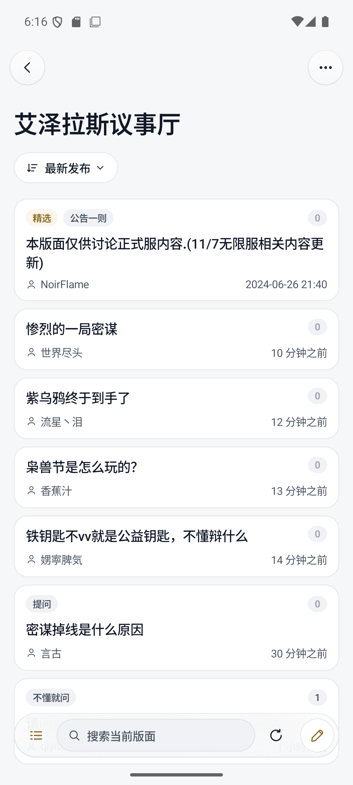
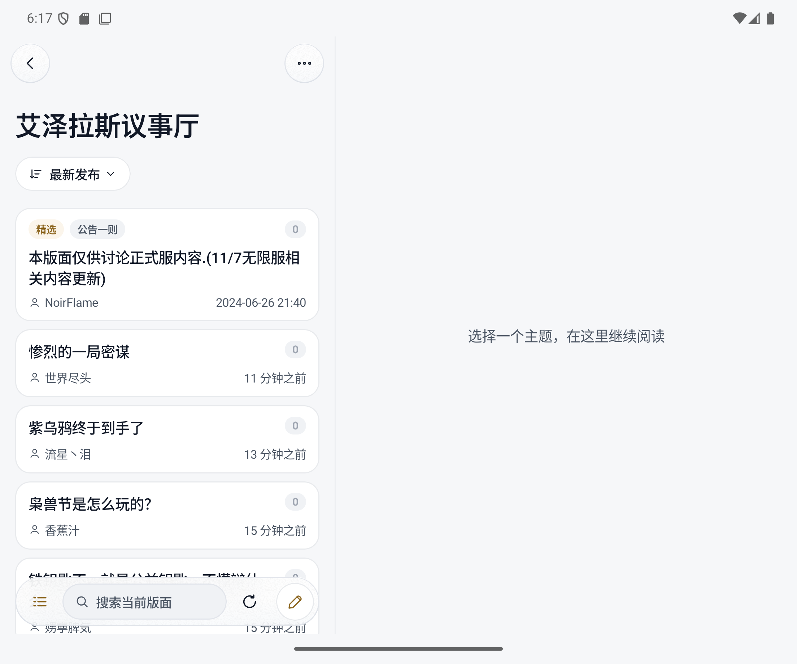

# Nagi

Nagi 是一个非官方 NGA Android 客户端，使用 Kotlin 和 Jetpack Compose，侧重论坛阅读。

## 功能

- 版块目录、主题搜索、分页阅读、只看楼主和阅读位置记录。
- 原生帖子排版，支持引用、代码、折叠、图片、GIF 和 NGA 表情。
- 浅色 / 深色主题、阅读字号设置，以及按窗口宽度切换的列表与正文布局。
- 多账号登录；凭据使用 Android Keystore 加密保存，本地数据按账号隔离。
- 本地版块与主题收藏，不同步 NGA 云端收藏。
- 通知、用户资料、主题与回复列表，以及发帖、回复、编辑、评分和私信界面。
- 子板块显示设置，修改的是 NGA 当前账号的服务端设置，不是本地收藏。

写入功能目前以模拟测试为主，真实发帖、编辑、评分、私信和子板块设置尚未完成验证。
图片上传、富文本表格单元格和图片缩放尚未实现。真机折叠行为、无障碍及性能仍需测试，
不能从自适应布局或模拟器截图推断。更多检查项见 [界面验收](docs/design/review.md)。

## 截图

艾泽拉斯议事厅帖子列表，截自 Android 模拟器。展开态通过调整模拟器为 2208×1840 尺寸展示，
仅演示宽屏布局，不代表真实折叠行为已验证。

| 竖屏 | 折叠屏展开尺寸（模拟） |
| --- | --- |
|  |  |

## 构建

需要 JDK 21 和 Android SDK 36

```sh
./gradlew :nga-sdk:check :app:assembleDebug :app:lintDebug :app:testDebugUnitTest
```

调试版 APK 位于 `app/build/outputs/apk/debug/app-debug.apk`。
Google / Maven 仓库无法访问时，可追加 `-PchinaMirror` 使用 Aliyun HTTPS 镜像。

仅构建 JVM SDK，不需要 Android SDK：

```sh
./gradlew -PsdkOnly :nga-sdk:build
```

连接模拟器或设备后运行本地插桩测试：

```sh
./gradlew :app:connectedDebugAndroidTest
```

真实 NGA 只读冒烟测试需要显式开启，可能受网络或服务端限制：

```sh
NAGI_READ_SMOKE=1 ./gradlew -PsdkOnly :nga-sdk:smoke
```

自动化不得向真实账号发帖或修改设置；此类测试需要事先批准、专用账号和安全流程。

### 发布版签名

通过环境变量提供私有签名配置：

| 变量 | 内容 |
| --- | --- |
| `NAGI_SIGNING_STORE_FILE` | 密钥库绝对路径 |
| `NAGI_SIGNING_STORE_PASSWORD` | 密钥库密码 |
| `NAGI_SIGNING_KEY_ALIAS` | 密钥别名 |
| `NAGI_SIGNING_KEY_PASSWORD` | 密钥密码 |

运行 `./gradlew :app:assembleRelease`，产物位于 `app/build/outputs/apk/release/`。
缺少配置时签名失败，不会回退到调试密钥。不要把密钥、密码或含密码的命令行历史提交到仓库；
在仓库外保存加密备份。后续更新需使用相同签名并递增 `versionCode`。
替换不同签名的安装包通常需要卸载，卸载会清除本地数据。

GitHub Actions 会在 PR 和 `master` 推送时执行检查并提供 Debug APK；推送 `vMAJOR.MINOR.PATCH`
标签时，检查通过后自动构建签名 APK 并发布 GitHub Release。标签须指向 `master` 历史中的提交，
且匹配 `versionName`。密钥生成、GitHub Secrets 配置和发版步骤见[发布指南](docs/releasing.md)。

## 致谢

感谢 [nga-qing](https://github.com/qing-yi-5427/nga-qing)、
[nga-just-works](https://github.com/tophtab/nga-just-works)和
[MNGA](https://github.com/BugenZhao/MNGA) 及其贡献者提供协议与网络实现参考，
以及 Kotlin、AndroidX、OkHttp 等开源项目。
Nagi 与 NGA 无隶属关系，论坛内容及远程图片归各自权利人所有。

## 许可

项目许可见 [LICENSE](LICENSE)。第三方组件保留各自的许可证，依赖清单、许可文本及适用声明见
[第三方许可](third-party/README.md)；APK 的“关于与反馈 → 开源许可”可离线查看这些材料。
依赖变更后需要同步审核许可清单，构建会检查 Debug / Release 运行时依赖是否与清单一致。

## 代码与文档

- `app/`：Compose 界面、导航、ViewModel、登录与本地存储。
- `nga-sdk/`：独立 Kotlin/JVM 协议库，不依赖 Android 界面。
- [SDK 协议说明](docs/sdk-networking.md)：请求、解析、错误及写入语义。
- [设计规范](docs/design/README.md)、[页面说明](docs/design/screens.md)、[界面验收](docs/design/review.md)。
- [开发约束](AGENTS.md)。
