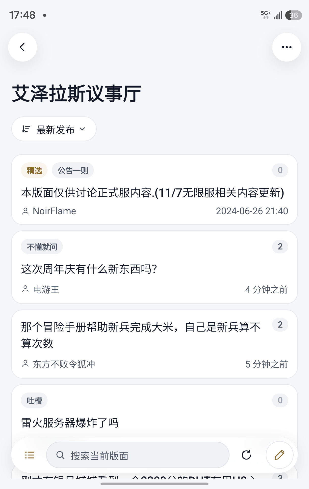
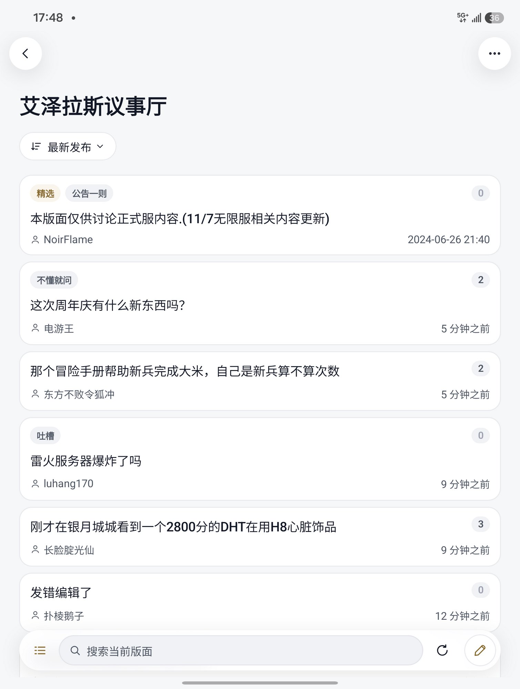
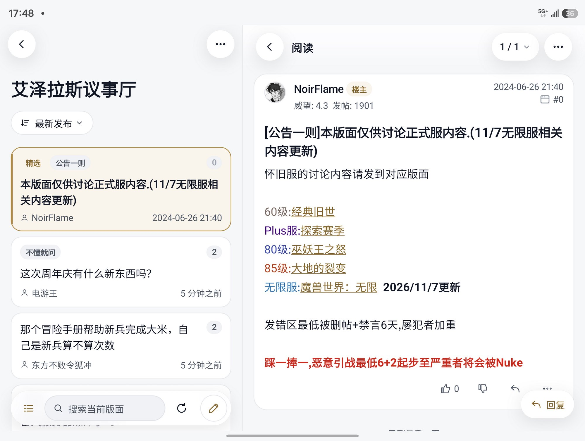

<div align="center">


# Nagi

一个基于 Kotlin 与 Jetpack Compose 的非官方 NGA Android 客户端，侧重论坛阅读体验。

[](https://github.com/Yarnus/nagi/actions/workflows/build.yml)
[](https://github.com/Yarnus/nagi/releases/latest)
[](https://github.com/Yarnus/nagi/releases)
[](LICENSE)


[功能特性](#功能特性) · [界面截图](#界面截图) · [下载与安装](#下载与安装) · [开发与构建](#开发与构建) · [代码与文档](#代码与文档)

</div>

## 功能特性

- **阅读与浏览**：支持版块目录、主题搜索、分页阅读、只看楼主与阅读位置记录。
- **原生富文本排版**：原生 Compose 渲染标题、颜色、字号、对齐、列表、富文本表格、引用、代码、折叠、图片、GIF 与 NGA 表情；音视频与附件可调用外部打开。
- **自适应界面与主题**：支持浅色 / 深色主题、阅读字号设置，以及按窗口宽度自动切换的列表与正文双栏布局。
- **多账号与数据隔离**：支持多账号登录；凭据使用 Android Keystore 加密保存，本地数据按账号隔离。
- **收藏与互动**：本地版块与主题收藏（不同步 NGA 云端收藏）；包含通知、用户资料、主题与回复列表，以及发帖、回复、编辑、评分、私信界面与服务端当前账号的子板块显示设置。

> [!NOTE]
> 写入功能目前以模拟测试为主，真实发帖、编辑、评分、私信和子板块设置尚未完成验证。复杂 CSS 版头和合并单元格布局尚未实现。真机折叠行为、无障碍及性能仍需测试，不能从自适应布局或模拟器截图推断。更多检查项见 [界面验收](docs/design/review.md)。

## 界面截图

艾泽拉斯议事厅帖子列表与阅读器截图，展示竖屏、折叠屏展开单栏与展开双栏布局。

| 竖屏 | 折叠屏展开（单栏） | 折叠屏展开（双栏） |
| :---: | :---: | :---: |
|  |  |  |

## 下载与安装

前往 [GitHub Releases](https://github.com/Yarnus/nagi/releases/latest) 下载对应架构的独立 APK：

| ABI 架构 | 适用设备 |
| --- | --- |
| `arm64-v8a` | 大多数现代手机与平板（推荐） |
| `armeabi-v7a` | 旧款 32 位 ARM 设备 |
| `x86_64` | Intel 设备或对应架构的 Android 模拟器 |

## 开发与构建

构建完整 Android 应用需要 **JDK 21** 和 **Android SDK 36**：

```sh
./gradlew :nga-sdk:check :app:assembleDebug :app:lintDebug :app:testDebugUnitTest
```

调试版 APK 位于 `app/build/outputs/apk/debug/app-<abi>-debug.apk`（Debug / Release 均按 `arm64-v8a`、`armeabi-v7a`、`x86_64` 分别生成独立 APK）。Google / Maven 仓库无法访问时，可追加 `-PchinaMirror` 使用 Aliyun HTTPS 镜像。

### 其他常用命令

- **仅构建 JVM SDK**（不需要 Android SDK）：
  ```sh
  ./gradlew -PsdkOnly :nga-sdk:build
  ```
- **连接模拟器或设备后运行本地插桩测试**：
  ```sh
  ./gradlew :app:connectedDebugAndroidTest
  ```
- **真实 NGA 只读冒烟测试**（需要显式开启，可能受网络或服务端限制）：
  ```sh
  NAGI_READ_SMOKE=1 ./gradlew -PsdkOnly :nga-sdk:smoke
  ```

> [!CAUTION]
> 自动化不得向真实账号发帖或修改设置；此类测试需要事先批准、专用账号和安全流程。

<details>
<summary>发布版签名与 GitHub Actions CI 发版说明</summary>

通过环境变量提供私有签名配置：

| 变量 | 内容 |
| --- | --- |
| `NAGI_SIGNING_STORE_FILE` | 密钥库绝对路径 |
| `NAGI_SIGNING_STORE_PASSWORD` | 密钥库密码 |
| `NAGI_SIGNING_KEY_ALIAS` | 密钥别名 |
| `NAGI_SIGNING_KEY_PASSWORD` | 密钥密码 |

运行 `./gradlew :app:assembleRelease`，产物位于 `app/build/outputs/apk/release/`。缺少配置时签名失败，不会回退到调试密钥。不要把密钥、密码或含密码的命令行历史提交到仓库；在仓库外保存加密备份。后续更新需使用相同签名并递增 `versionCode`。替换不同签名的安装包通常需要卸载，卸载会清除本地数据。

GitHub Actions 会在 PR 和 `master` 推送时执行检查并提供 Debug APK；推送 `vMAJOR.MINOR.PATCH` 标签时，不重复运行检查，而是验证同一提交的最新 `master` 推送 CI 已成功，再构建签名 APK 并发布 GitHub Release。标签须指向 `master` 历史中的提交，且匹配 `versionName`。如果标签推早了，等待 `master` CI 成功后重跑失败任务即可。密钥生成、GitHub Secrets 配置和发版步骤见 [发布指南](docs/releasing.md)。

</details>

## 代码与文档

| 模块 / 文档 | 说明 |
| --- | --- |
| `app/` | Compose 界面、导航、ViewModel、登录与本地存储 |
| `nga-sdk/` | 独立 Kotlin/JVM 协议库，不依赖 Android 界面 |
| [SDK 协议说明](docs/sdk-networking.md) | 请求、解析、错误及写入语义 |
| [设计规范](docs/design/README.md) | 视觉规范、[页面说明](docs/design/screens.md)、[界面验收](docs/design/review.md) |
| [开发约束](AGENTS.md) | 架构边界、变更验证与安全准则 |

## 致谢

感谢 [nga-qing](https://github.com/qing-yi-5427/nga-qing)、[nga-just-works](https://github.com/tophtab/nga-just-works) 和 [MNGA](https://github.com/BugenZhao/MNGA) 及其贡献者提供协议与网络实现参考，以及 Kotlin、AndroidX、OkHttp 等开源项目。Nagi 与 NGA 无隶属关系，论坛内容及远程图片归各自权利人所有。

## 许可

项目许可见 [LICENSE](LICENSE)。第三方组件保留各自的许可证，依赖清单、许可文本及适用声明见 [第三方许可](third-party/README.md)；APK 的“关于与反馈 → 开源许可”可离线查看这些材料。依赖变更后需要同步审核许可清单，构建会检查 Debug / Release 运行时依赖是否与清单一致。
